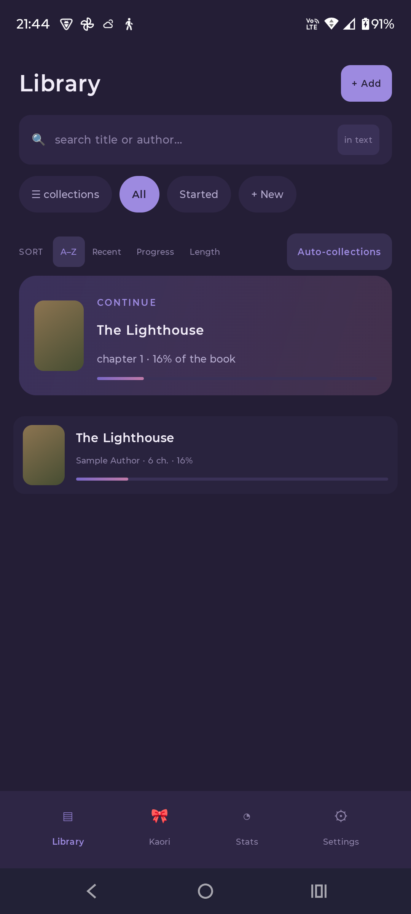
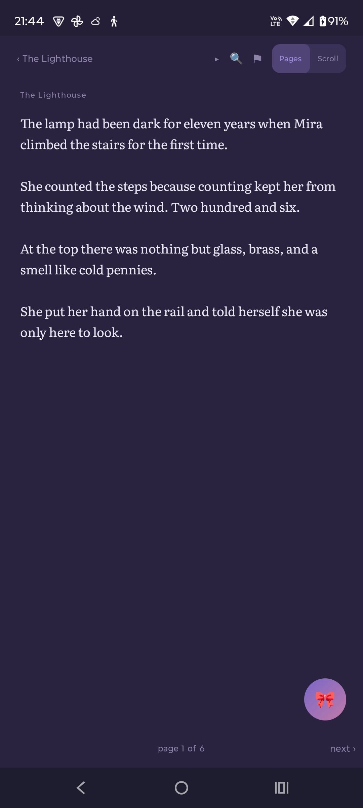
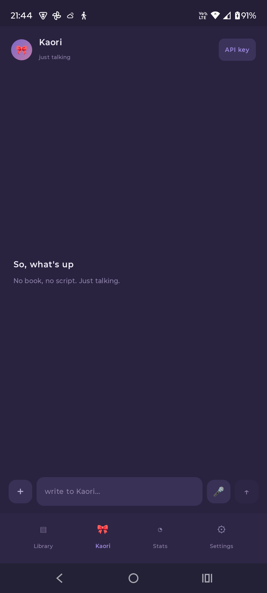
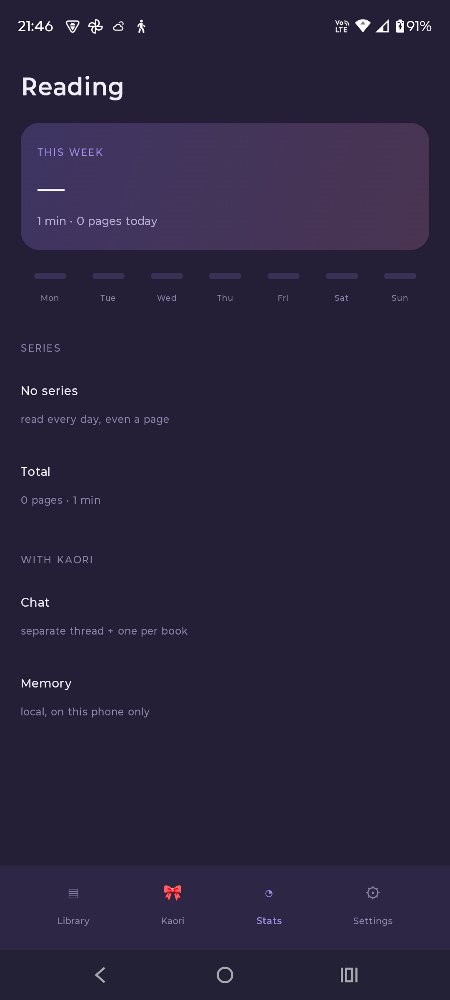

# KaoriReader

An Android EPUB reader with a companion who reads **with** you — and who is not allowed
to spoil the book.

No account, no server, no telemetry. Your books, your progress and your API key stay on
your phone.

| Library | Reader |
|---|---|
|  |  |

| Companion | Stats |
|---|---|
|  |  |

---

## What it does

**Reader**
- EPUB 2/3 with illustrations in place (inline in scroll mode, full-page in page mode)
- two reading modes: pages or continuous scroll, both surviving chapter boundaries
- library with collections, multi-select, folder import (SAF)
- full-text search **inside a book** and **across the whole library**, jumping to the exact line
- bookmarks with exact position, reading progress that never gets lost
- built-in TTS: reads a page aloud and turns to the next one

**Companion (bring your own key)**
- any OpenAI-compatible endpoint: OpenAI, OpenRouter, DeepSeek, Groq, or your own URL
- she sees the book you are reading, reacts to it, argues about characters
- **spoiler guard** — she only receives the text you have actually read. Skipped pages are
  not in her context at all, so she cannot leak them, even if the model has seen the book
  during training
- **local memory** — facts, open threads and conversation summaries, stored on the device
  (no vector database, no embeddings, no network beyond the model call)
- **personas** — Kaori (built in) or your own: name, emoji, language, tone, rules.
  A description is enough; the model fills in the rest
- strict in-character mode: no "as an AI", no meta-commentary, no lists

**Your data**
- export/import backup of progress, collections, bookmarks and stats (JSON)
- memories are viewable and deletable one by one, or wiped entirely
- API keys encrypted with Android Keystore, `allowBackup=false`

---

## Install (no PC, no cable)

1. On your phone, open the **[latest release](https://github.com/Grandpa2137/KaoriReader/releases/latest)**.
2. Download the latest `KaoriReader-<version>.apk`.
3. Tap the downloaded file. Android will ask once to allow installs from this source —
   allow it for the browser you used, then tap **Install**.
4. The app is now on your home screen. No account, no sign-in, no cable.

Updates work the same way: download the newer APK and install it over the old one —
books, progress, collections and memory stay in place.

### Automatic updates (Obtainium)

[Obtainium](https://github.com/ImranR98/Obtainium) installs apps straight from a GitHub repo
and tells you when a new release appears.

1. Install Obtainium (its own APK is on its releases page).
2. Add app → paste `https://github.com/Grandpa2137/KaoriReader` → Add.
3. From then on every new `KaoriReader-x.y.z.apk` release shows up as an update.

The file you already installed can stay — same signing key, so it updates in place.

---

## Build

```bash
# requirements: JDK 17, Android SDK 35, Gradle 8.9
cd android
./gradlew assembleDebug
# APK: app/build/outputs/apk/debug/app-debug.apk
```

Windows:

```powershell
$env:JAVA_HOME='C:\path\to\jdk'
cd android
gradle assembleDebug --no-daemon
```

`local.properties` with `sdk.dir=...` is required (or set `ANDROID_HOME`).

---

## How the spoiler guard works

The app never asks the model to "please not spoil". It simply does not send the text.

1. Every page you actually dwell on (≥2 s) is recorded as a character range.
   Jumping with the table of contents or search marks nothing.
2. Those ranges are merged into a per-book set of read ranges.
3. When you write to the companion, she gets only the text from those ranges.
4. Memories never store plot — only durable facts about you — so a summary of chapter 30
   cannot leak at chapter 2.

You can see exactly what she has been given: the badge in the chat header opens a preview
of the text that was sent.

---

## Privacy

- No analytics, no crash reporting, no remote config.
- The only outbound requests are the ones you trigger: the model API you configured,
  an optional page fetch when you paste a link, and weather for the built-in persona.
- Keys live in Android Keystore; backups are excluded (`allowBackup="false"`).

---

## Licence

MIT. EPUB files are yours — none are shipped with the app.

---

## Credits

Made by **Grandpa** — and honestly labelled: this app was **vibecoded**.

That means the architecture, the decisions and every test on a real phone were driven
by a human, while large parts of the code were written in pair-programming sessions
with an AI assistant. If you find something that looks like it was written by a person
who was having fun rather than following a spec — that is exactly what happened.

The persona text of Kaori is original writing. The app ships no book content and no voice
model, and it has no server of its own.
